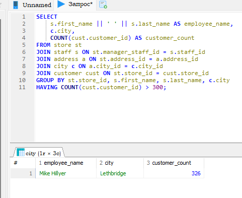
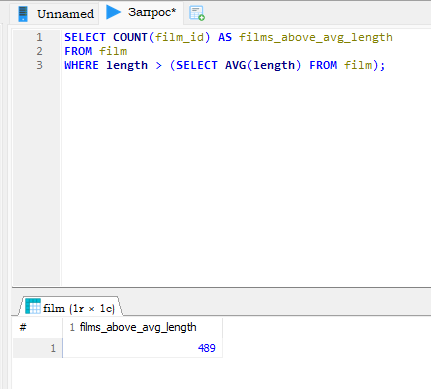
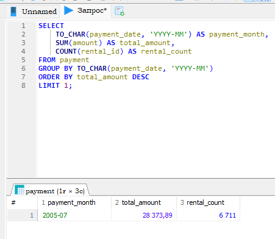
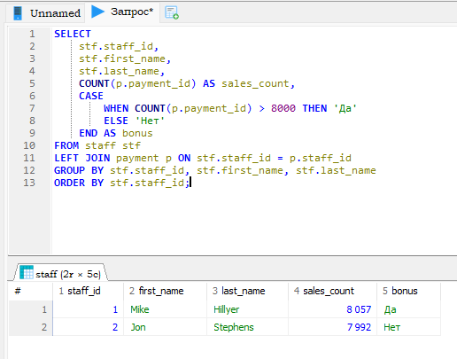
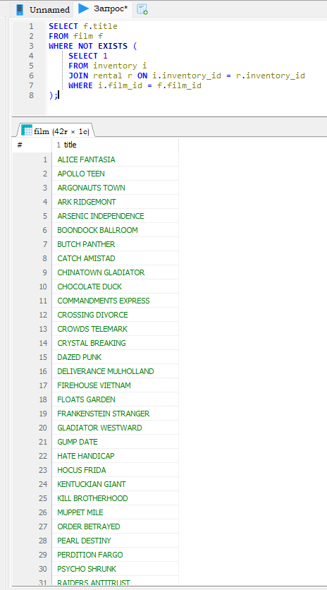

# Домашнее задание к занятию "`SQL. Часть 2`" - `Сидоренко Алексей`

---

### Задание 1
Одним запросом получите информацию о магазине, в котором обслуживается более 300 покупателей.

`**SQL-запрос:**`
```sql
SELECT 
    s.first_name || ' ' || s.last_name AS employee_name,
    c.city,
    COUNT(cust.customer_id) AS customer_count
FROM store st
JOIN staff s ON st.manager_staff_id = s.staff_id
JOIN address a ON st.address_id = a.address_id
JOIN city c ON a.city_id = c.city_id
JOIN customer cust ON st.store_id = cust.store_id
GROUP BY st.store_id, s.first_name, s.last_name, c.city
HAVING COUNT(cust.customer_id) > 300;
```

`**Скриншот:**`


---

### Задание 2
Получите количество фильмов, продолжительность которых больше средней продолжительности всех фильмов.

`**SQL-запрос**`
```sql
SELECT COUNT(film_id) AS films_above_avg_length
FROM film 
WHERE length > (SELECT AVG(length) FROM film);
```

`**Скриншот:**`


---

### Задание 3
Получите информацию, за какой месяц была получена наибольшая сумма платежей, и добавьте информацию по количеству аренд за этот месяц.

`**SQL-запрос**`
```sql
SELECT 
    TO_CHAR(payment_date, 'YYYY-MM') AS payment_month,
    SUM(amount) AS total_amount,
    COUNT(rental_id) AS rental_count
FROM payment
GROUP BY TO_CHAR(payment_date, 'YYYY-MM')
ORDER BY total_amount DESC
LIMIT 1;
```

`**Скриншот:**`


---

### Задание 4
Посчитайте количество продаж, выполненных каждым продавцом. Добавьте вычисляемую колонку «Премия».

`**SQL-запрос**`
```sql
SELECT 
    stf.staff_id,
    stf.first_name,
    stf.last_name,
    COUNT(p.payment_id) AS sales_count,
    CASE 
        WHEN COUNT(p.payment_id) > 8000 THEN 'Да'
        ELSE 'Нет'
    END AS bonus
FROM staff stf
LEFT JOIN payment p ON stf.staff_id = p.staff_id
GROUP BY stf.staff_id, stf.first_name, stf.last_name
ORDER BY stf.staff_id;
```

`**Скриншот:**`


---

### Задание 5
Найдите фильмы, которые ни разу не брали в аренду.

`**SQL-запрос**`
```sql
SELECT f.title
FROM film f
WHERE NOT EXISTS (
    SELECT 1 
    FROM inventory i 
    JOIN rental r ON i.inventory_id = r.inventory_id 
    WHERE i.film_id = f.film_id
);
```

`**Скриншот**`

